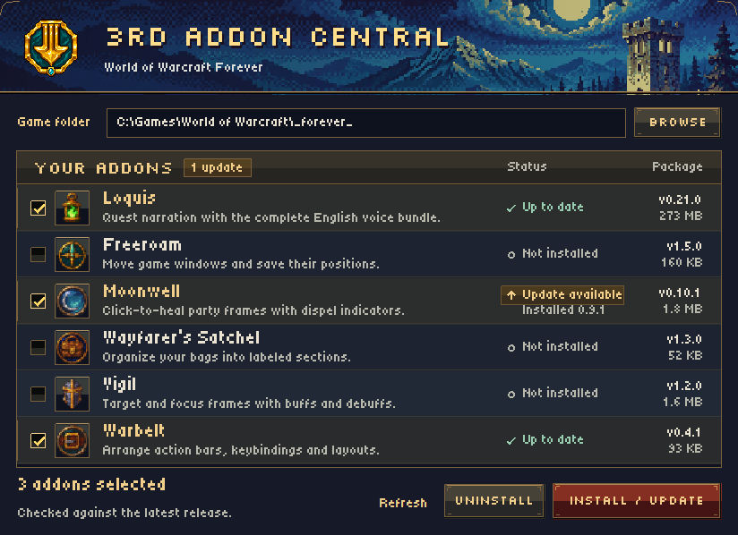

# 3RD Addon Central

A small Windows app for installing, updating and removing your WoW Forever addons.

**[Download 3RD Addon Central for Windows](https://github.com/TheThirdBeast/wow-forever-addons/releases/latest/download/ForeverAddons.exe)**

1. Open ForeverAddons.exe. It finds WoW Forever using Battle.net and local game libraries. If it finds multiple installations, choose one.
2. Check the addons you want, close WoW, and click **Install / Update**. The app remembers your choices.
3. Open the app again to see available updates. A gold **Update available** badge shows the installed and available versions. **Refresh** checks again. **Install / Update** downloads only changed packages.

## Uninstalling an addon

Close WoW, click **Uninstall**, choose the addon, and confirm. This removes its installed folders, bundled voice packs, updater backup and saved variables across all accounts and characters in that WoW installation. It clears the addon's enablement entries and Warbelt-specific click bindings where applicable. Unchecking a box only stops future updates.

## Addons

| Addon | What it does |
| --- | --- |
| Loquis | Plays recorded English quest dialogue and captions. Includes the quest voice packs. |
| Freeroam | Moves game windows and remembers their positions. |
| Moonwell | Adds click-to-heal party frames and dispel indicators. |
| Wayfarer's Satchel | Organizes your bags into labeled sections. |
| Vigil | Shows target and focus frames with buffs and debuffs. |
| Warbelt | Arranges action bars, keybindings and layouts. |

Requires Windows with .NET Framework 4.8. Downloads are public GitHub release assets. The app verifies each package before installing it under the selected client's _forever_/Interface/AddOns folder.
